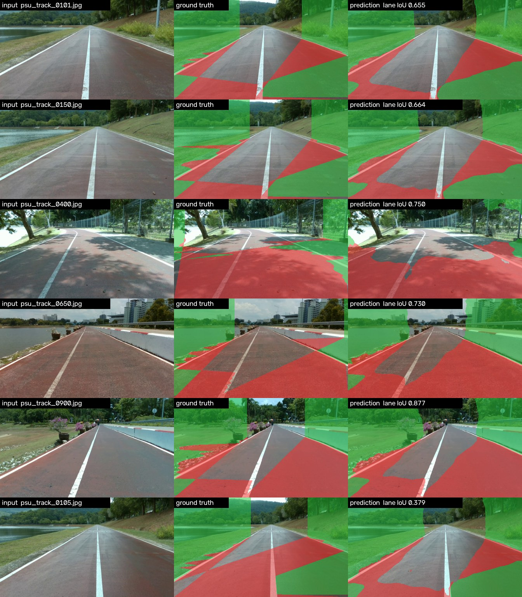
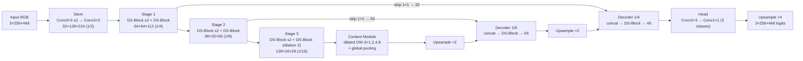
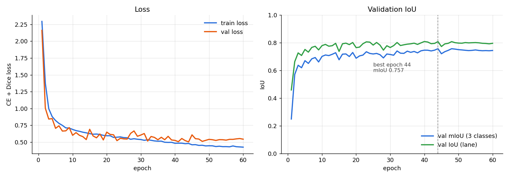

# Assignment-10: Lane Segmentation Neural Network from Scratch

**241-353 AI Ecosystem** · Lane segmentation บนชุดข้อมูล **PSU-Reservoir** (polygon เท่านั้น) ด้วยโมเดล **TinyLaneSeg** ที่ออกแบบเองและเทรนทุก layer จาก random weights

| | |
|---|---|
| ผู้จัดทำ | นายกันต์กวี รามศรี (6610110408) |
| Dataset | PSU-Reservoir-Track-1000 (กลุ่มเดียวกับ Assignment-8) — 1,000 เฟรม 1280×720 |
| Model | **TinyLaneSeg** — 264,451 พารามิเตอร์ (1.0 MB fp32) · 1.36 GFLOPs ต่อภาพ 256×448 |
| ผลบน test set (200 ภาพ) | **mIoU 0.726** · **Lane IoU 0.751** · mDice 0.841 · pixel acc 0.841 |
| Memory ตอน inference | RAM เพิ่ม ~22 MB (peak RSS ทั้ง process 248 MB รวม PyTorch runtime) · GPU (Apple MPS) 51 MB |
| ความเร็ว (Apple M1, batch 1) | 10 ms/ภาพ (100 FPS) บน MPS · 38 ms/ภาพ (26 FPS) บน CPU |


*ซ้าย: ภาพก่อน inference · กลาง: ground truth · ขวา: ผลหลัง inference (แดง = lane, เขียว = sideway) — แถวสุดท้ายคือภาพที่ผลแย่ที่สุดใน test set*

---

## 1. ข้อมูลที่ใช้ (Polygon only)

ไฟล์ label เป็นรูปแบบ YOLO-seg (`class x1 y1 x2 y2 ...`) มี 5 class ตาม datacard ของกลุ่ม แต่ assignment นี้ให้ใช้ **เฉพาะ polygon** จึงเลือกดังนี้

| YOLO class | ชนิดเดิม | ใช้ไหม | mask label |
|---|---|---|---|
| 0 `Lane` | polygon | ✅ | 1 = lane |
| 4 `Sideway` | polygon | ✅ | 2 = sideway |
| 1–3 `Track_Line_L/C/R` | **polyline** ที่ถูกขยายเป็น polygon บาง ๆ | ❌ ตัดทิ้ง | – |
| (พื้นที่ที่ไม่มี label) | – | – | 0 = background |

polygon ถูก rasterize เป็น semantic mask 3 class ที่ขนาด 256×448 (คงสัดส่วน 16:9 ของภาพเดิม) — วาด Sideway ก่อนแล้ว Lane ทับ (`src/dataset.py`) สัดส่วนพิกเซลแต่ละ class ใกล้เคียงกัน (~33% ต่อ class) จึงไม่มีปัญหา class imbalance มากนัก

### การแบ่ง train / val / test แบบ block (กัน data leakage)
ทั้ง 1,000 เฟรมมาจาก **วิดีโอเดียวกัน** เฟรมติดกันห่างกันแค่ ~1.3 วินาทีและแทบเหมือนกัน — split เดิมของ dataset เป็นแบบสุ่ม (เช่น เฟรม 4, 7, 12 อยู่ val แต่ 5, 6 อยู่ train) ถ้าใช้ตรง ๆ คะแนน test จะสูงเกินจริงเพราะโมเดลเคยเห็นภาพเกือบเดียวกันแล้ว

จึงแบ่งใหม่เป็น **block ละ 50 เฟรมต่อเนื่อง** แล้วให้ทั้ง block ไปอยู่ชุดเดียวกัน:

| ชุด | block (index) | จำนวนภาพ |
|---|---|---|
| train | ที่เหลือทั้งหมด | 700 |
| val (เลือก best checkpoint) | 4, 14 | 100 |
| **test (held-out)** | 2, 7, 12, 17 → เฟรม 101–150, 351–400, 601–650, 851–900 | **200** |

test จึงเป็น "ช่วงของเส้นทางที่โมเดลไม่เคยเห็น" กระจายทั่วทั้งเส้นทางรอบอ่างเก็บน้ำ

---

## 2. โครงสร้าง Neural Network: TinyLaneSeg



**DS-Block** (depthwise-separable residual block) = `DW3×3 → BN → ReLU → PW1×1 → BN → ReLU → DW3×3 → BN → PW1×1 → BN` + shortcut (identity หรือ AvgPool + 1×1 conv เมื่อเปลี่ยนขนาด) → ReLU

| Block | Output (C×H×W) | Params |
|---|---|---:|
| stem | 32×128×224 | 5,136 |
| stage1 | 64×64×112 | 19,488 |
| stage2 | 96×32×56 | 44,768 |
| stage3 | 128×16×28 | 80,288 |
| context | 128×16×28 | 47,136 |
| skip8 + dec8 | 64×32×56 | 38,144 |
| skip4 + dec4 | 48×64×112 | 15,504 |
| head (+ upsample) | 3×256×448 | 13,987 |
| **รวม** | | **264,451** |

### เหตุผลในการออกแบบ

1. **Encoder–decoder + skip connections (แนว U-Net/DeepLabv3+ แบบย่อ)** — segmentation ต้องการทั้งบริบทภาพรวม (ส่วนไหนคือทาง) และขอบที่คมระดับพิกเซล การลดขนาดถึง 1/16 ให้ receptive field กว้าง ส่วน skip จาก 1/8 และ 1/4 นำรายละเอียดขอบกลับมาใน decoder
2. **Depthwise-separable convolution แทน conv ปกติ** — โจทย์กำหนดให้รันบน laptop ได้ DW+PW ใช้พารามิเตอร์/FLOPs น้อยกว่า conv 3×3 ปกติราว 8–9 เท่าที่ความกว้างเท่ากัน ทั้งโมเดลจึงมีแค่ 0.26M พารามิเตอร์ (U-Net มาตรฐานมี ~31M, เล็กกว่า ~100 เท่า)
3. **Context module แบบ multi-dilation (ASPP ขนาดเล็ก)** — lane/ทางวิ่งเป็นวัตถุยาวที่พาดจากล่างจอถึงจุดหายลับ ต้องมองเห็นบริบทกว้างมาก การใช้ dilation 1, 2, 4, 8 ขยาย receptive field ได้โดยไม่ต้อง downsample เพิ่ม (ซึ่งจะทำให้เสียความละเอียด) และ branch global pooling ให้ข้อมูลระดับทั้งภาพ เช่น สภาพแสง
4. **Residual shortcut + BatchNorm + Kaiming init** — เพราะไม่มี pretrained weights ต้องให้ gradient ไหลดีตั้งแต่ epoch แรก shortcut และ BN ช่วยให้เทรนจากศูนย์ได้เสถียร
5. **Input 256×448 แทน 1280×720** — คงสัดส่วนภาพ 16:9 (ไม่บีบภาพเป็นสี่เหลี่ยมจัตุรัสจนรูปทรงทางบิดเบี้ยว) ลดพิกเซลลง ~8 เท่า และหารด้วย 16 ลงตัวตาม stride ของ encoder
6. **Decoder เบา + bilinear upsampling** — ใช้ bilinear แทน transposed conv เพื่อลดพารามิเตอร์และไม่เกิด checkerboard artifact

---

## 3. การเทรน

| ค่า | |
|---|---|
| Init | Kaiming normal ทุก conv (ไม่มี pretrained weights เลย) |
| Loss | Cross-Entropy + multi-class Dice loss (CE เรียนรายพิกเซล, Dice เน้น overlap ของรูปทรงทั้งก้อน) |
| Optimizer | AdamW, weight decay 1e-4 |
| LR schedule | OneCycle, max LR 3e-3, warm-up 10% |
| Batch / Epochs | 16 / 60 |
| Augmentation (ทำบน GPU) | brightness/contrast/saturation jitter (แดด/เงา), horizontal flip, random zoom 1.0–1.25× + shift |
| เครื่อง | MacBook Apple M1 (8 GB RAM) ผ่าน PyTorch MPS — ~60 วินาที/epoch, รวม ~60 นาที |
| Checkpoint | เลือกจาก val mIoU สูงสุด → epoch 44 |

### กราฟ Loss



- train loss ลดจาก 2.29 → 0.42 และ val loss จาก 2.16 → ~0.50–0.54 แสดงว่าโมเดล **ลู่เข้า (converge)**
- val loss แกว่งช่วง epoch 10–45 ตอน LR สูง แล้วนิ่งเมื่อ LR ลดตาม OneCycle
- ช่วง epoch 45–60 train loss ยังลดเล็กน้อยแต่ val loss ทรงตัว/ขึ้นนิดหน่อย = เริ่ม overfit เล็กน้อย จึงใช้ checkpoint ที่ epoch 44 (val mIoU 0.757)
- log ทุก epoch อยู่ใน `results/train_log.txt` และ `results/history.json`

---

## 4. ผลการวัดประสิทธิภาพ (Test set 200 ภาพ, held-out blocks)

| Class | IoU | Dice (F1) | Precision | Recall |
|---|---:|---:|---:|---:|
| background | 0.702 | 0.825 | 0.825 | 0.824 |
| **lane** | **0.751** | **0.858** | 0.854 | 0.862 |
| sideway | 0.725 | 0.841 | 0.844 | 0.837 |
| **mean** | **mIoU 0.726** | **mDice 0.841** | | |

- Pixel accuracy: **0.841**
- Lane IoU รายภาพ: median 0.752, ต่ำสุด 0.379 (`psu_track_0105`, แถวล่างสุดของภาพด้านบน)
- ไฟล์ผลเต็ม + confusion matrix: `results/metrics_test.json`

### ข้อสังเกตเรื่องคุณภาพ label (สำคัญต่อการอ่านตัวเลข)
label ของ dataset นี้ **สร้างอัตโนมัติด้วย OpenCV heuristic** (HSV threshold + contour ตาม datacard) ไม่ได้วาดด้วยมือ ดังนั้น ground truth มีรูปทรงเรขาคณิตที่ไม่ตรงกับพื้นผิวจริง เช่น สามเหลี่ยมขอบตรงบนทางวิ่ง หรือสี่เหลี่ยมสีเขียวใหญ่มุมบนซ้าย/ขวาของทุกเฟรม (ดูคอลัมน์กลางของภาพตัวอย่าง) โมเดลเรียนรู้ pattern เหล่านี้ได้ส่วนใหญ่ แต่ขอบที่ไม่สอดคล้องกับเนื้อภาพจริงทำให้ IoU มีเพดานอยู่ — ในหลายภาพผลทำนายตามขอบทางจริงดีกว่า label ด้วยซ้ำ (เช่น `psu_track_0105`) ตัวเลขนี้จึงเป็นการวัด "ความตรงกับ label" มากกว่าความแม่นยำต่อโลกจริง

นอกจากนี้ตัวเลขวัดบน **block ที่ไม่เคยเห็น** ไม่ใช่เฟรมสุ่มจากวิดีโอเดียวกัน จึงเป็นการประเมินแบบเข้มงวดกว่า random split

---

## 5. Memory footprint ตอน inference

วัดด้วย `python benchmark.py` บน Apple M1 (8 GB), PyTorch 2.7.1, ภาพ 1×3×256×448, fp32

| รายการ | ค่า |
|---|---:|
| จำนวนพารามิเตอร์ | 264,451 |
| ขนาดพารามิเตอร์ (fp32) | 1.01 MB |
| ขนาดไฟล์ weights `weights/best.pt` | 1.12 MB |
| Compute | 0.68 GMACs (1.36 GFLOPs) |
| Activation ที่ใหญ่ที่สุดหนึ่งก้อน | 3.5 MB |
| ผลรวม activation ทุก layer (ขอบบน, ไม่ได้อยู่พร้อมกันจริง) | 116 MB |
| RAM ที่เพิ่มขึ้นจากการโหลด + รันโมเดลบน CPU | ~22 MB |
| Peak RSS ของทั้ง process (รวม PyTorch runtime ~200 MB) | 248 MB |
| GPU memory (MPS driver allocated) | 51 MB |
| Latency / FPS — MPS GPU | 10.0 ms / 100 FPS |
| Latency / FPS — CPU 4 threads | 38.2 ms / 26 FPS |

สรุป: ตัวโมเดลใช้หน่วยความจำระดับไม่กี่สิบ MB ส่วนใหญ่ของ RAM คือตัว PyTorch เอง จึงรันบน laptop/PC ทั่วไปได้สบาย แม้ไม่มี GPU ก็ยังได้ ~26 FPS (ผลดิบ: `results/benchmark.json`)

---

## 6. วิธีรัน

```bash
pip install -r requirements.txt

# 1) เทรน (สร้าง mask cache ครั้งแรกอัตโนมัติที่ data/)
python train.py --data-dir /path/to/psu_reservoir_dataset --epochs 60

# 2) วัดผลบน test set
python evaluate.py --weights weights/best.pt

# 3) สร้างภาพ before/after
python predict.py --snapshots 6
python predict.py --image some_frame.jpg --out results/my_pred.png

# 4) กราฟ loss และ memory benchmark
python plot_curves.py
python benchmark.py --weights weights/best.pt
```

`--data-dir` คือโฟลเดอร์ YOLO-seg ที่มี `images/{train,val}` และ `labels/{train,val}` (split ใหม่คำนวณจากเลขเฟรมเอง)

## 7. โครงสร้าง repo

```
├── src/
│   ├── model.py        # TinyLaneSeg (ออกแบบเอง, Kaiming init)
│   ├── dataset.py      # polygon → mask, block split, GPU augmentation
│   └── metrics.py      # IoU / Dice / confusion matrix, CE + Dice loss
├── train.py            # เทรน + log loss/mIoU ทุก epoch
├── evaluate.py         # วัดผลบน test set → results/metrics_test.json
├── predict.py          # ภาพ before/after
├── benchmark.py        # memory footprint + latency
├── plot_curves.py      # results/loss_curve.png
├── weights/best.pt     # checkpoint ที่ดีที่สุด (1.1 MB)
└── results/            # กราฟ, metrics, snapshots, train log
```

## อ้างอิง
- Ronneberger et al., *U-Net* (2015) — แนวคิด encoder–decoder + skip connection
- Howard et al., *MobileNets* (2017) — depthwise-separable convolution
- Chen et al., *DeepLabv3+* (2018) — atrous/dilated context module
- ตัวอย่างงานที่อาจารย์แนะนำ: [Ultrafast-Lane-Detection-Inference-Pytorch](https://github.com/ibaiGorordo/Ultrafast-Lane-Detection-Inference-Pytorch-), [YOLOTL](https://github.com/Highsky7/YOLOTL)
